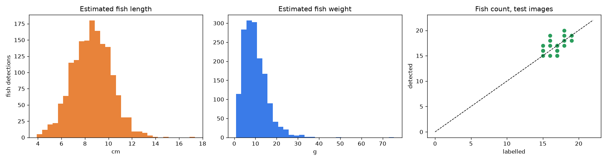

# AquaPense: Fish Size, Weight and Feed Estimation

You give the system a photo of the aquarium. It finds every fish, estimates how long and how heavy each one is, and works out how much food the tank needs per day.

```
Tank photo → Find fish → Keep the clear ones → Measure length → Convert to cm → Estimate weight → Calculate feed
```

---

## How it works, step by step

### 1. Finding the fish (object detection)
- **Technique:** a **YOLO11n** deep-learning model trained to find fish.
- **Training data:** 215 photos of the tank with 3,555 fish hand-labelled in Roboflow.
- **Output:** a box around every fish.
- **Accuracy on unseen test photos:** mAP50 = 98.5%, precision 94%, recall 95%.

### 2. Keeping only fish that can be measured fairly (quality filter)
A fish only shows its true length when it is seen **side-on**. Every fish is **counted**, but these are **not measured**:

| Skipped fish | Why |
|---|---|
| Near the left or right side glass | The curved side glass shows reflections and stretched images |
| Overlapping another fish | Part of the body is hidden |
| Swimming towards the camera or diving | The body looks shorter than it really is |
| Cut off at the image edge | Only part of the fish is visible |

The interface draws measured fish in **green** and counted-only fish in **grey**.

### 3. Measuring the length in pixels (image processing)
- **Technique:** **colour segmentation** with OpenCV. Goldfish are orange, so the orange/red pixels inside each box are picked out to form the fish's outline.
- **Technique:** **Principal Component Analysis (PCA)** on the outline finds the direction the body points, and the length is measured along that direction.
- **Why not just use the box width?** A tilted fish makes a bigger box than its real length. Measuring along the body avoids that.

### 4. Converting pixels to centimetres (camera calibration)
A single camera can't see how far a fish is from the glass. Near fish look big and far fish look small. Two known reference widths deal with this:

- The **front glass** and the **back wall** of the tank have the same real width (the tank width, e.g. 90 cm).
- In the photo, the front glass looks wider (closer) and the back wall looks narrower (farther).
- That gives two scales:
  - fish at the front → `cm = pixels ÷ (front pixels per cm)`, the **smallest** possible size
  - fish at the back → `cm = pixels ÷ (back pixels per cm)`, the **largest** possible size
- The system reports the **middle value** as its estimate and shows the min–max range.

> ⚠️ Measure your tank's inner width and enter it in the app. Every cm and gram value depends on it.

### 5. Length to weight (length–weight relationship)
In fish biology, weight is predicted from length with this standard formula:

```
W = a × L^b
```

For goldfish (*Carassius auratus*), FishBase gives **a = 0.01288** and **b = 3.04**, with **L** in cm and **W** in grams.

| Length | Weight |
|---|---|
| 6 cm | ≈ 3 g |
| 8 cm | ≈ 7 g |
| 10 cm | ≈ 14 g |
| 12 cm | ≈ 24 g |

Because weight grows with roughly length³, a **10% length error becomes about a 34% weight error**. That is why the quality filter matters.

### 6. Calculating the feed
```
Total fish weight (biomass) = number of fish × average fish weight
Daily feed (g)              = biomass × feed rate (%)
Feed per meal               = daily feed ÷ meals per day
```
The feed rate (default 2% of body weight per day), the number of meals and the fish count can all be changed in the app.

---

## Results (215 tank images)

| What | Result |
|---|---|
| Fish count error (21 test images) | ±1.1 fish per image (6.6%) |
| Fish measured | 1,587 of 3,542 detected |
| Average length | 8.6 cm |
| Average weight | 9.9 g (range 7.8–12.3 g depending on depth) |
| Example tank (17 fish) | ≈ 169 g of fish → **≈ 3.4 g of feed per day** |



---

## Limitations
- **One camera:** a fish's distance from the glass is unknown, so each fish's weight can be off by about ±20%. Averaging several photos reduces random error.
- **Weights not yet checked against real fish:** to confirm accuracy, weigh and measure a few fish and compare them with the app.
- **Trained on one tank:** a new tank, camera or lighting may need new training photos.

## Future improvements
- Train a **segmentation model (YOLO-seg)** for more accurate fish outlines.
- Use a **second camera (stereo vision)** to measure each fish's real distance.
- Connect the feed output to an **automatic feeder** (ESP32 + servo).

---

## How to run

```bash
python3 -m venv .venv
.venv/bin/pip install -r requirements.txt
.venv/bin/streamlit run app.py       # opens the interface at http://localhost:8501
.venv/bin/python evaluate.py         # makes the report in results_weight/
```

In the app, upload a tank photo, set the tank width and feed rate in the sidebar, and read the recommended feed.

## Project files

| File | What it does |
|---|---|
| `app.py` | Web interface (Streamlit) |
| `fishsize/core.py` | The steps above: filter, measure, convert, weigh, feed |
| `evaluate.py` | Runs the system on all images and makes the results report |
| `results_weight/` | Results: figures, CSV files, summary |
| `Training-*/Training/` | YOLO training code, notebook, training report and trained model (`best.pt`) |

## Tools used
Python, Ultralytics YOLO11, PyTorch, OpenCV, NumPy, Pandas, Matplotlib, Streamlit, Roboflow (labelling).
